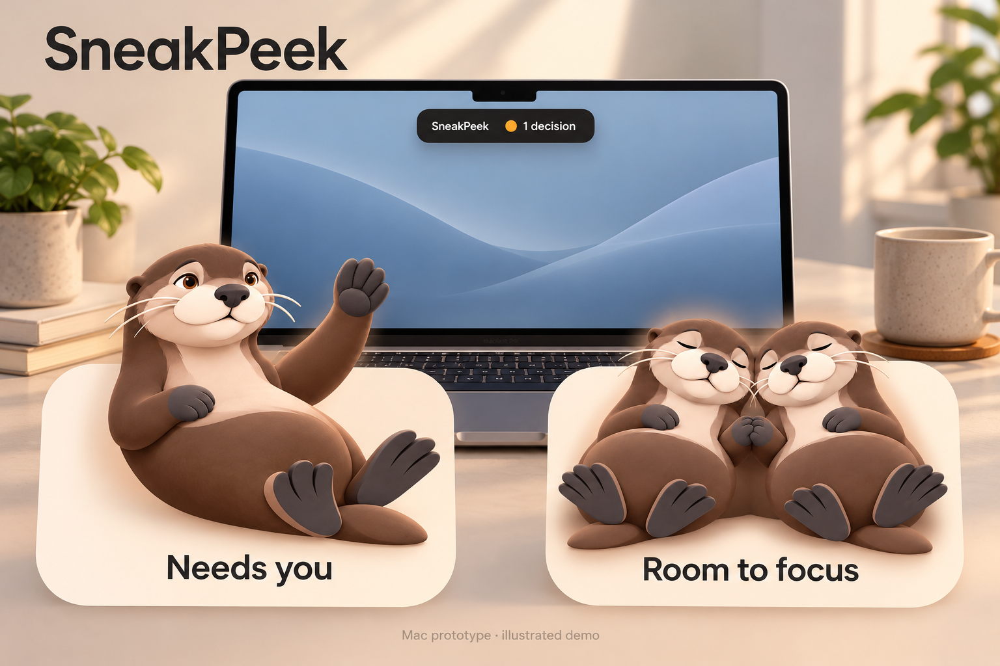

# SneakPeek

A quiet native Mac companion for long-running agent missions. Hover at the notch to see where the team is heading, what progress has been reported, and which decision needs you. Collapse it and get back to your work.

Version 0.3.1 is a **local research prototype** supporting **Codex, Claude Code, Antigravity, and GitHub Copilot**, including locally logged subagents. It runs on macOS 14+ with a Swift 6 toolchain (Xcode or Apple's Command Line Tools), Python 3.9+, and zsh. There are no third-party runtime packages, account connections, or inference calls in the observer. **Manage harnesses…** shows every connection even between builds and can register another harness without rebuilding the app.

For the Antigravity/Copilot test and additional harnesses, use the [harness connection guide](docs/harnesses.md).

The goal is supervision of hundreds or thousands of agents through mission-level evidence and a bounded queue of human decisions. This version has **not** been validated at that scale. Read the [scale architecture and current limits](docs/scaling.md), [security/privacy boundaries](SECURITY.md), and [contributor and adversarial-review guide](CONTRIBUTING.md).



*AI-generated Mac mockup using the Cove character artwork, not an actual screenshot. Resting represents a clear attention queue, not a verified mission outcome.*

## First visit?

- **Try the local app:** build from source below, then choose **Try demo** before observing your own sessions. This is a development build, not a notarized installer.
- **Try Cove:** choose **Appearance → Otter**, or build the [separate synthetic gesture demo](docs/cove-gestures-guide.txt). Demo apps and ZIPs are generated locally; they are not included in a source clone.
- **Explore Taste:** the [human-action simulation](docs/human-action-simulation.md) demonstrates hunches, reviews, and resolutions. Production human authentication and automatic steering of workers are not available.

Found a confusing signal, missing harness event, or setup problem? [Report a bug or give feedback](https://github.com/hehamalainen/SneakPeek/issues/new/choose) with a small synthetic example. Use [private reporting](https://github.com/hehamalainen/SneakPeek/security/advisories/new) for sensitive security findings.


## Run

```sh
git clone https://github.com/hehamalainen/SneakPeek.git
cd SneakPeek
./scripts/test.sh
./scripts/build.sh
./scripts/run.sh
```

SneakPeek appears at the top center of the built-in display, and in the menu bar. Hover to peek; move away to collapse. Pin it to keep it open. Escape collapses it when the panel has keyboard focus. The menu also opens the peek and quits the app. External displays without a notch use the same top-center position.

Use **Try demo** for an example mission. Its decision buttons send a real local reply to a simulated waiting agent. Example data is labeled throughout. Use **Go live** to return to your own sessions. `./scripts/run.sh --demo --expanded` opens the example immediately.

By default the observer discovers local sessions updated in the past 24 hours. The harness manager can extend this to 7 or 30 days and explains when a detected harness has no recent sessions. To scope it to one project:

```sh
./scripts/run.sh --project /absolute/path/to/project
```

The app enforces a single running instance; opening it again reveals the existing peek. Quit first when changing launch options or installing a new build. Runtime state defaults to `~/Library/Application Support/SneakPeek`, outside the supervised checkout. An explicit `--state /absolute/path/state.json` selects an alternate directory. Existing `runtime/` data is not automatically migrated. See [the Claude review follow-up](docs/claude-review.md) for trust boundaries and manual migration.

## Trust model

Host permissions stay in Codex or Claude by default. Inline file-based approvals
require explicit trusted-local opt-in. Evidence reviews, Taste judgments and the
feed remain unsigned claims: native acceptance no longer trusts their verified
fields. Production human signing is unavailable and its authenticated count stays
zero. A [separate human-action simulation](docs/human-action-simulation.md) lets
you try native signed review, Taste and resolution with an ephemeral software key
and an explicitly simulated Touch ID step. Its counts always say **SIMULATED**.
See [security and privacy](SECURITY.md) for the release prerequisites.

Local evidence references are shown in Finder rather than launched. HTTPS
references open in the browser. Inspect a referenced file before accepting it.

## Optional Cove companion

Choose **Appearance → Otter** for Cove, or use the separate synthetic gesture
demo. [Cove instructions](docs/cove-gestures-guide.txt) explain its gestures,
floating companion and isolated build. The demo app, ZIP and GIFs are **generated
locally by the packaging command**, and are not included in a source clone.
The main app is independent of this demo.

## Define the destination

Choose a mission and click its pencil. Give it a clear outcome and two or three observable landing checks. A **finished turn** is not the same as a **verified mission**.

**Inspect** opens the mission's evidence. Attach an artifact file or HTTPS reference to a check and inspect it. Reports remain unsigned claims. The native human-action experiment binds reviews to the complete current definition and exact evidence snapshot; **Check met**, **Check not met**, and Taste signing are available in the separate simulation. Ordinary builds explain that production authentication is unavailable. Old bare “verified” labels and sidecar reviews cannot establish native acceptance. First-prompt goals remain inferred until locally edited.

The **Queue** distinguishes host decisions and judgment requests from evidence gaps and suspected drift. The separate simulation exercises **Taste…** (“feels right,” “feels off,” or uncertainty), optional review requests, and signed resolution. Taste affects only checks explicitly defined as **Human taste**. Read the [mission tracking and handoff contract](docs/mission-tracking.md) for the underlying unsigned research transport, and the [simulation guide](docs/human-action-simulation.md) for the stricter native experiment.

Agents can publish a short progress checkpoint:

```sh
python3 bridge/peek.py checkpoint \
  --agent 'codex:SESSION_UUID' \
  --evidence 'The integration suite passes; the decision reached the waiting process.' \
  --next 'Review the hover flow on a MacBook display' \
  --trajectory onCourse
```

Use `--checkpoint CHECK_ID --reference /absolute/path/to/test-result.txt` to attach an evidence record to a landing check from the selected `state.json`. Without a reference, a checkpoint is only a progress report. `atRisk` flags that a human should review the course; `unknown` leaves alignment unassessed. These labels are explicitly agent-reported. Checkpoints preserve the live session's subsequent activity and completion state.

## Decisions and host approvals

**Codex and Claude retain permissions in their own UI by default.** SneakPeek observes and hands off to the source session. No unsigned decision file is applied by the default adapters. The small managed Codex runner refuses to launch without the explicit trusted-local opt-in; start Codex normally for host-owned permissions.

### Optional trusted local prototype

The file-based inline permission experiment is available only when **every process able to write the state directory is trusted**. A peer writer can forge an approval. Moving state out of the repo reduces accidental sandbox exposure; it does not authenticate a human or defeat a same-account process with wider access. Review [SECURITY.md](SECURITY.md) before opting in.

For one Claude invocation:

```sh
python3 scripts/claude-settings.py --trusted-local-inline
claude --settings "$HOME/Library/Application Support/SneakPeek/claude-settings.json"
```

The generator does not modify active Claude configuration. Without `--trusted-local-inline`, its hook immediately leaves permission handling with Claude. With the opt-in, it displays the complete tool input and waits up to two minutes; Allow applies only to that step, Decline denies, and an unavailable surface or expiry returns to Claude's own handling. Existing host policies remain in effect.

For a managed Codex experiment:

```sh
python3 bridge/codex_runner.py --trusted-local-inline \
  --project "$PWD" \
  --goal 'Implement the requested change and report validation evidence.'
```

This starts a real Codex turn using your installed CLI, authentication, configured sandbox and approval defaults; normal model usage can apply. It owns a separate app-server and does not attach to another client's session. Replies are bound to the exact request and wait for host acknowledgement, but they are unsigned and forgeable by a local writer. Expiry cancels, a disconnected live surface stops the owned process, and unsupported rich requests require the full host interface.

Do not opt in for hostile or drifting agents with access to the supervisor state. Use host approvals while the authenticated transport described in [the security handoff](docs/claude-review.md) remains unimplemented.

## Session handoff

### Antigravity

The observer discovers public transcripts in Antigravity 2.0, Antigravity IDE, and Antigravity CLI. It reads only public response text; the separate `thinking` field is ignored. A completed transcript step is labeled **Update observed**, because it does not establish that the whole agent loop has stopped. Conversation artifacts can be opened, and the exact conversation ID copied for selection in the source app.

For authoritative start/stop and tool-error events, generate an optional lifecycle hook fragment:

```sh
python3 scripts/antigravity-hooks.py
```

Merge the `sneakpeek-observer` entry from `~/Library/Application Support/SneakPeek/antigravity-hooks.json` into `.agents/hooks.json` in an Antigravity project, or configure it in Antigravity's Customizations > Hooks. Preserve other hooks. The generator does not modify active configuration. These hooks observe `PreInvocation`, `PostInvocation`, `PostToolUse`, and `Stop`; they do not register a permission gate or change tool permissions. `Stop` marks a turn finished only when `fullyIdle` is true and no stop error is reported. Without hooks, project-scoped monitoring excludes Antigravity transcripts whose workspace cannot be established. Questions and approvals remain in Antigravity's UI in this version.

Codex handoff attempts the local `codex://threads/…` deep link and also copies `codex resume SESSION_UUID`. If your installed client does not handle that URL, use the copied command. Claude handoff copies `claude --resume SESSION_UUID`; paste it into a terminal in the session's project. Logged subagent sessions may need their parent session for resume. This version does not control another app's terminal windows or approve prompts by clicking their UI.

## Verification

```sh
./scripts/test.sh
```

Tests cover request scope, invalid and expired replies, missing observers, partial log writes, nested subagent grouping, private-reasoning exclusion, checkpoint overlays, Claude hook round trips, a full Codex app-server subprocess round trip with a mock host, and Antigravity foreground/background completion semantics. Mission tests cover evidence freshness and review binding, conflicting reports, stale editor saves, Taste separation, and a synthetic 1,000-mission grouping scenario. A Swift integration test decodes the actual Python projection. These are correctness checks, not a fleet capacity benchmark. The script also accommodates the Testing framework location in Apple's Command Line Tools. No model call is made by these tests.

## Prototype limits

- Local session logs are a best-effort observation source. Their schemas can change, and they do not expose every permission or question. Discovery keeps the 100 newest eligible logs per harness and reports omitted logs as incomplete coverage; that cap also applies before project filtering.
- Lights show observed activity and explicit requests. Five minutes without an event is labeled quiet, not automatically failed or in need of human intervention.
- The app surfaces course risks explicitly reported by agents; it does not yet judge semantic drift automatically.
- No remote agents, push notifications, sound, auto-start, or background cloud service.
- The build uses ad-hoc signing for local development. Distribution needs proper signing and notarization.
- The observer retains recent visible prompt/message excerpts locally. Runtime files should be treated like local session data.

Protocol references: [Codex app-server](https://learn.chatgpt.com/docs/app-server), [Claude Code hooks](https://code.claude.com/docs/en/hooks), and [Antigravity lifecycle hooks](https://www.antigravity.google/docs/hooks).

Licensed under the [MIT License](LICENSE).
